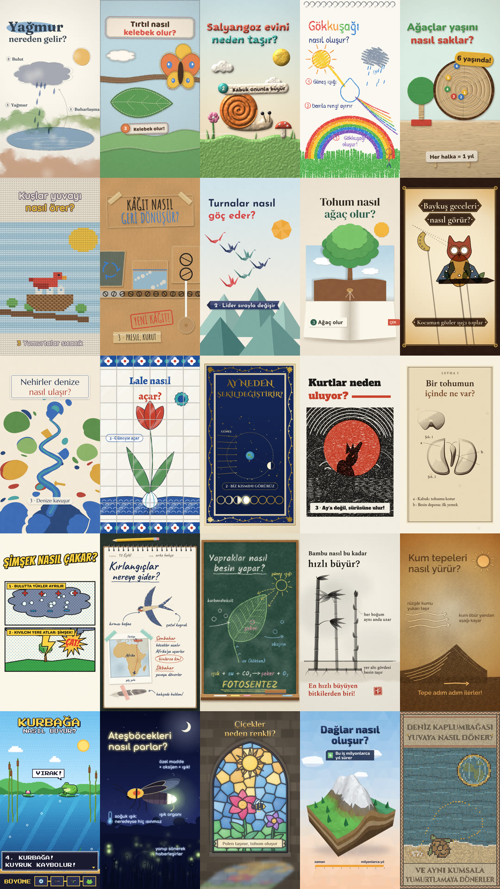

<h1 align="center">Kaleydo</h1>

<p align="center"><i>Bir konu, yirmi beş bakış.</i></p>

<p align="center"><b>Çocuklara doğayı sevdiren kısa animasyon videoları için 25 görsel stil,<br>canlı önizlemeler ve tek tıkla eksiksiz video promptu.</b></p>

<p align="center">
  <a href="#stiller">Stiller</a> ·
  <a href="#hızlı-başlangıç">Hızlı başlangıç</a> ·
  <a href="#yeni-stil-eklemek">Yeni stil</a> ·
  <a href="#english">English</a>
</p>

<p align="center"></p>

## Neler var?

- **25 görsel stil, 4 kategori.** Her stilin 8 saniyelik döngü önizlemesi, Canvas ile yazılmış kaynak kodu, künyesi (palet, yazı tipleri, imza öğeleri) ve yapay zekânın stili yeniden kurabileceği kadar ayrıntılı bir **stil rehberi** var.
- **Galeri sitesi.** Kategoriye göre süz, ara, favorilerini işaretle, büyük önizlemeyi ya da tarayıcıda canlı çizimi izle, paletteki renkleri tek dokunuşla kopyala. Açık / koyu tema.
- **Konu fikirleri.** 7 grupta 46 çocuk dostu doğa sorusu, her birine yakışan stillerle; "Rastgele konu" düğmesi. Kendi yazdığın konuya da uygun stiller önerilir.
- **Prompt oluşturucu.** Stil + konu + süre + format + ses seçimlerinden, kod yazabilen bir yapay zekâ asistanına verilecek eksiksiz üretim talimatı hazırlar: bilgi doğruluğu, hikâye akışı, stil kuralları, kodlama yöntemi, ses ve son kontroller tek metinde.
  - **Kanal kimliği:** kanal adı, açılış satırı ve kapanış kartı her bölümde aynı kalır.
  - **Yayın paketi:** YouTube başlığı, açıklama ve etiketler; 1280×720 kapak görseli; `.srt` altyazı.
  - **Seri modu:** her satıra bir konu yaz, tüm bölümlerin promptlarını tek dosyada indir.
  - **Paylaşılabilir bağlantı:** aynı ayarlarla açılan bir adres kopyalar.
- **Üretim araçları.** Kare kare deterministik çizim motoru, tarayıcıdan videoya aktarıcı, kodla ses efekti ve fon müziği üreten karıştırıcı.
- **Asistan becerileri.** `.claude/skills/` altında `video` (tek cümleyle video) ve `yeni-stil` (bir görselden yeni stil); bu klasörü tanıyan kodlama asistanları bunları doğrudan kullanır.
- **Örnek proje.** "Arılar nasıl bal yapar?" videosunun (25 sn, 9:16) tüm kaynağı: [`examples/arilar-bal`](examples/arilar-bal).

Önizlemelerin tamamı kodla çizildi; hiçbir hazır görsel, video ya da ses dosyası kullanılmadı.

## Stiller

| # | Stil | English | Önizleme konusu | Kısaca |
|---|---|---|---|---|
| 01 | [Sulu Boya Masalı](styles/01-sulu-boya-masali/style.md) | Watercolor Tale | Yağmur nereden gelir? | Saydam boya katmanları, ıslak kenarlar ve kurşun kalem taslağı |
| 02 | [Keçe Diyarı](styles/02-kece-diyari/style.md) | Felt Land | Tırtıl nasıl kelebek olur? | Tüylü kenarlı keçe parçalar, dikiş izleri ve düğmeler |
| 03 | [Hamur Dünyası](styles/03-hamur-dunyasi/style.md) | Clay World | Salyangoz evini neden taşır? | Işıkla şişen oyun hamuru, parmak izleri ve stop-motion |
| 04 | [Pastel Karalama](styles/04-pastel-karalama/style.md) | Crayon Doodle | Gökkuşağı nasıl oluşur? | Çocuk elinden mum boya: taşan taramalar, titreşen çizgiler |
| 05 | [Ahşap Oyuncak](styles/05-ahsap-oyuncak/style.md) | Wooden Toy | Ağaçlar yaşını nasıl saklar? | Boyalı ahşap parçalar, görünen damarlar ve atmış boya kenarları |
| 06 | [Yün Örgü](styles/06-yun-orgu/style.md) | Knitted Yarn | Kuşlar yuvayı nasıl örer? | Bütün görüntü ilmek ilmek örülmüş bir kazak deseni |
| 07 | [Karton Atölye](styles/07-karton-atolye/style.md) | Cardboard Workshop | Kâğıt nasıl geri dönüşür? | Oluklu karton, koli bandı, keçeli kalem ve damga |
| 08 | [Origami](styles/08-origami/style.md) | Origami | Turnalar nasıl göç eder? | Düz yüzeylerle katlanmış kâğıt, kendi kendine katlanan karakterler |
| 09 | [Pop-up Kitap](styles/09-popup-kitap/style.md) | Pop-up Book | Tohum nasıl ağaç olur? | Sayfadan ayağa kalkan katmanlar, çekmeli şeritler, kaldırmalı kapakçıklar |
| 10 | [Hayal Perdesi](styles/10-hayal-perdesi/style.md) | Shadow Play | Baykuş geceleri nasıl görür? | Mum ışığıyla aydınlanan perde, renkli deriden yarı saydam figürler |
| 11 | [Ebru Akışı](styles/11-ebru-akisi/style.md) | Marbling Flow | Nehirler denize nasıl ulaşır? | Gerçek ebru matematiği: birbirini iten damlalar, tığla çekilen damarlar |
| 12 | [Çini Bahçesi](styles/12-cini-bahcesi/style.md) | Tile Garden | Lale nasıl açar? | Sır altına fırçayla boyanmış karo pano: kobalt, turkuaz ve mercan kırmızısı |
| 13 | [Tezhip Işıltısı](styles/13-tezhip-isiltisi/style.md) | Gilded Illumination | Ay neden şekil değiştirir? | Varak altın, lacivert zemin ve aharlı kâğıt; ışık vurdukça parlayan tezhip |
| 14 | [Linol Oyma](styles/14-linol-oyma/style.md) | Linocut Print | Kurtlar neden uluyor? | İki renkli kabartma baskı: oyma izleri, mürekkep boşlukları, kayık kırmızı kalıp |
| 15 | [Botanik Gravür](styles/15-botanik-gravur/style.md) | Botanical Engraving | Bir tohumun içinde ne var? | Bakır gravür levha: yalnızca tarama çizgileriyle ton, harfli şekiller ve lejant |
| 16 | [Çizgi Roman](styles/16-cizgi-roman/style.md) | Comic Book | Şimşek nasıl çakar? | Basılı çizgi roman sayfası: kalın mürekkep panelleri, Ben-Day noktaları, ses efekti patlamaları |
| 17 | [Doğa Defteri](styles/17-doga-defteri/style.md) | Field Journal | Kırlangıçlar nereye gider? | Gezgin bir doğa bilimcinin spiralli defteri: kurşun kalem eskiz, suluboya lekeler, dolma kalem notlar |
| 18 | [Tebeşir Tahtası](styles/18-tebesir-tahtasi/style.md) | Chalkboard Lesson | Yapraklar nasıl besin yapar? | Sınıftaki yeşil tahta: renkli tebeşirle canlı çizilen ders, tozlu hale, silgiyle temizlenen tahta |
| 19 | [Mürekkep Fırça](styles/19-murekkep-firca/style.md) | Ink Brush | Bambu nasıl bu kadar hızlı büyür? | Lifli kâğıda tek renk mürekkep: kuru fırça darbeleri, bol boşluk, kırmızı mühür |
| 20 | [Kum Masası](styles/20-kum-masasi/style.md) | Sand Table | Kum tepeleri nasıl yürür? | Işıklı masada kum animasyonu: dökülen koyu kum, parmakla açılan parlak çizgiler, avuçla silinen sahne |
| 21 | [Piksel Bahçe](styles/21-piksel-bahce/style.md) | Pixel Garden | Kurbağa nasıl büyür? | Özgün retro oyun sahnesi: sert pikseller, titreşimli renk geçişleri, daktilo diyalog kutusu ve seviye çubuğu |
| 22 | [Gece Işıltısı](styles/22-gece-isiltisi/style.md) | Night Glow | Ateşböcekleri nasıl parlar? | Ay ışığında bir çayır: koyu lacivert gece, kıpırdayan yıldızlar, kendi ışığını saçan canlılar |
| 23 | [Vitray Işığı](styles/23-vitray-isigi/style.md) | Stained Glass Light | Çiçekler neden renkli? | Taş duvarda sivri kemerli vitray: kurşun çerçeveli renkli camlar, içinden süzülen ve yere düşen ışık |
| 24 | [Low-Poly Vadi](styles/24-low-poly-vadi/style.md) | Low-Poly Valley | Dağlar nasıl oluşur? | Düz gölgeli üçgen yüzeylerden kurulmuş 3B diorama: kesit yüzlerinde kaya katmanları, koni ağaçlar |
| 25 | [Mozaik Taş](styles/25-mozaik-tas/style.md) | Stone Mosaic | Deniz kaplumbağası yuvaya nasıl döner? | Hareket eden antik taş mozaik: harç arasında binlerce tessera, zikzak bordür, taşlarla yazılmış yazıt |

Kategoriler: **El Yapımı** (01–09) · **Geleneksel Sanatlar** (10–13) · **Baskı & Çizim** (14–20) · **Işık & Dijital** (21–25)

**Taslak stiller (26–37, şimdilik tek kare):** Siyanotip, Termal Kamera, Röntgen, Mikroskop, Nakış Kasnağı, Çıkartma Albümü, Neon Tabela, Kar Küresi, Eski Harita, Grafiti Duvarı, Dedektif Panosu, Sabun Köpüğü. Görseller: [`site/taslaklar`](site/taslaklar).

## Hızlı başlangıç

### 1. Sadece prompt (kurulum yok)

1. Siteyi aç (yerelde: depo klasöründe `python3 -m http.server 8000` → http://localhost:8000; yayındaysa GitHub Pages adresi), bir stil seç.
2. **Prompt oluştur** bölümünde konunu yaz; süreyi, formatı ve sesi seç.
3. **Kopyala** ya da **İndir (.md)**. Metni kod yazabilen bir yapay zekâya yapıştır: önce hikâye akışını, sonra çizimi, sesi ve kontrolleri yapar; sonunda `out/final.mp4` çıkar.

### 2. Kodlama asistanıyla, depo içinde

```bash
git clone https://github.com/aydinomer00/kaleydo.git
```

Depoyu kodlama asistanında aç; tek cümle yeter:

> 17 numaralı stille "Karıncalar yolu nasıl bulur?" videosu yap, 30 saniye olsun.

`video` becerisi stil rehberini, stilin çalışan kodunu ve ortak üretim kurallarını okur; `videos/<konu>/` altında hikâye akışını, çizimi, sesi ve `final.mp4` dosyasını hazırlar.

### 3. Elle (geliştiriciler için)

Gerekenler: **Node.js 18+**, **ffmpeg**, **Python 3 + NumPy**.

```bash
npm install
```

```bash
npx playwright install chromium
```

| İş | Komut |
|---|---|
| Siteyi yerelde aç | `python3 -m http.server 8000` → http://localhost:8000 |
| Bir stili canlı izle | http://localhost:8000/styles/preview.html?s=17-doga-defteri&play |
| Bir stilin önizleme videosu | `node tools/render.cjs 17-doga-defteri` |
| Bütün önizlemeler | `node tools/render.cjs all --workers=4` |
| Belirli anların karesi | `node tools/render.cjs 17-doga-defteri --stills=1,4,7.5` |
| Yeni bir video sayfası | `videos/_sablon` klasörünü `videos/<konu>` olarak kopyala |
| Videoyu sesle çıkar | `node tools/render.cjs videos/<konu>/index.html --audio=videos/<konu>/ses.wav --out=videos/<konu>/final.mp4` |
| Ses efektleri ve müzik | `python3 tools/ses.py karistir videos/<konu>/cues.json videos/<konu>/ses.wav` |
| Site verisini yenile | `node tools/build-site.cjs --kapak` |

## Klasör yapısı

```
├── index.html                 galeri + prompt oluşturucu (GitHub Pages ana sayfası)
├── site/                      sitenin stili, kodu, üretilen veri (data.js), konu bankası (konular.js) ve kapak görseli
├── styles/
│   ├── preview.html           canlı önizleme sayfası (?s=<klasör>&play)
│   └── NN-ad/
│       ├── preview.js         stilin Canvas kodu (8 sn, döngü)
│       ├── meta.json          künye: ad, kategori, palet, yazı tipleri, örnek konular
│       └── style.md           İngilizce stil rehberi (prompta eklenen metin)
├── previews/                  NN-ad.mp4 (540×960) ve NN-ad.jpg
├── prompts/govde.md           bütün stillerin paylaştığı üretim talimatı
├── engine/                    SH çizim araçları (core.js) ve yazı tipi tanımları
├── fonts/                     woff2 yazı tipleri (latin + latin-ext) ve lisansları
├── tools/                     render.cjs · build-site.cjs · ses.py
├── videos/_sablon/            yeni video için başlangıç sayfası
├── examples/arilar-bal/       örnek video projesi
└── .claude/skills/            video ve yeni-stil becerileri
```

## Nasıl çalışıyor?

- **Deterministik çizim.** Her sayfa `window.seek(t)` ile istenen anı her seferinde aynı şekilde çizer. Rastgelelik sabit tohumlu üreteçlerden gelir; dokular bir kez hazırlanır, her kare yalnızca birleştirilir. Bu sayede video kare kare, kayıpsız çıkarılır.
- **Türkçe harfler.** Her yazı tipinin `latin-ext` alt kümesi de yüklenir; ğ, ş, İ, ı gibi harfler her stilde denetlendi. Büyük harf kullanan stillerde i her zaman İ olur.
- **Dikey video güvenli alanı.** Yazılar ve önemli öğeler x 80–900, y 190–1450 piksel arasında tutulur (platform düğmeleri ve alt yazılar kenarları kapatır).
- **Ses.** Stok ses siteleri bulut makinelerinden indirmeyi çoğu zaman engellediği için efektler ve müzik `tools/ses.py` ile kodla üretilir; karışım yaklaşık −16 LUFS'e getirilir.
- **Prompt = gövde + rehber.** `prompts/govde.md` içindeki `{{TOPIC}}`, `{{DURATION}}`, `{{STYLE_GUIDE}}` gibi yer tutucular sitede seçimlerle doldurulur.

## Yeni stil eklemek

1. `styles/26-adi/` klasörünü aç; `preview.js` (8 sn, 1080×1920, döngü), `meta.json` ve `style.md` dosyalarını mevcut stillerle aynı yapıda yaz.
2. Yeni bir yazı tipi gerekiyorsa `fonts/` altına `latin` ve `latin-ext` woff2 dosyalarını ekle, `engine/fonts.css` dosyasına tanımla, lisansını `fonts/licenses/` altına koy.
3. Kontrol ve önizleme:
   ```bash
   node tools/render.cjs 26-adi --stills=1,4,7.9
   ```
   ```bash
   node tools/render.cjs 26-adi
   ```
4. Siteyi güncelle:
   ```bash
   node tools/build-site.cjs --kapak
   ```

Kodlama asistanına "Bu görselden yeni stil çıkar" demen yeterli; `yeni-stil` becerisi bu adımları yapar.

## GitHub Pages'te yayınlamak

Site derleme gerektirmez; `index.html` olduğu gibi yayınlanır.

1. **Settings → Pages → Build and deployment → Source: Deploy from a branch → Branch: `main` / `(root)` → Save.**
2. Birkaç dakika içinde site `https://aydinomer00.github.io/kaleydo/` adresinde açılır.

> Repo **private** olduğu sürece GitHub Pages ücretsiz hesapta kullanılamaz (GitHub Pro ya da üstü gerekir). O zamana kadar siteyi yerelde açmak yeterli: `python3 -m http.server 8000` → http://localhost:8000

## Künye

- **Yazı tipleri** (hepsi [SIL Open Font License 1.1](fonts/licenses), Fontsource üzerinden): Alegreya, Alfa Slab One, Amatic SC, Baloo 2, Bangers, Bricolage Grotesque, Caveat, Cinzel, Cinzel Decorative, Comfortaa, Cormorant Garamond, DM Sans, DM Serif Display, EB Garamond, Exo 2, Fraunces, Grandstander, Inter, Josefin Sans, Kalam, Marcellus, Nunito, Patrick Hand, Philosopher, Press Start 2P, Quicksand, Raleway, Spectral.
- **Görseller ve sesler:** depodaki kodla üretildi; dış kaynak kullanılmadı.
- **Kod ve içerik:** © 2026 aydinomer00 · Tüm hakları saklıdır. Ayrıntılar için [LICENSE](LICENSE).

---

## English

**Kaleydo** (*one topic, twenty-five ways to see it*) is a library of **25 visual styles** for short animated nature videos for children, with live previews and a one-click **prompt builder**.

- Every style has an 8-second looping preview written in plain Canvas 2D (`styles/NN-name/preview.js`), a metadata file and a detailed **style guide in English** (`style.md`): palette, materials, typography, composition, signature devices, how to build it, motion, transitions, information design, sound and things to avoid.
- The gallery site (`index.html`, GitHub Pages ready) lets you filter, preview and copy colours, and builds a complete production prompt from `prompts/govde.md` + the chosen style guide + your topic, duration, format and audio choices.
- Tools: a deterministic seek-based renderer (`tools/render.cjs`, headless Chromium → ffmpeg), a procedural sound-effects and music mixer (`tools/ses.py`, about −16 LUFS) and a site data builder (`tools/build-site.cjs`).
- Agent skills in `.claude/skills/`: `video` (make a video from a style number and a topic) and `yeni-stil` (derive a new style from a reference image).
- Everything is drawn and synthesised in code; no stock images, video or audio. Fonts are OFL-licensed.

Quick start: serve the folder (`python3 -m http.server 8000`), open the site, pick a style, type a topic, copy the prompt and paste it into a coding agent. Or clone the repo, open it in your coding agent and ask: *"Make a 30-second video in style 17 about how ants find their way."*

© 2026 aydinomer00. All rights reserved. Fonts are distributed under the SIL Open Font License 1.1 (see `fonts/licenses`).
