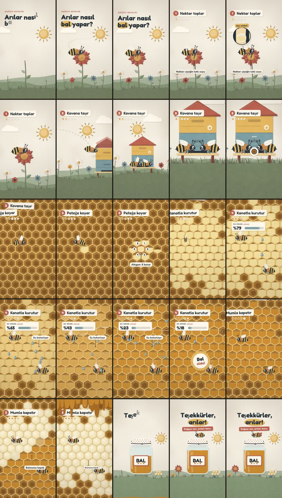

# Örnek video · Arılar nasıl bal yapar?

Kaleydo'deki stillerden önce yapılan ilk tam video: **25 saniye, 9:16 (1080×1920), 30 fps**, kâğıt kesik infografik görünümünde, sesleri tamamen kodla üretilmiş.



- [`arilar-bal.mp4`](arilar-bal.mp4) · bitmiş video (H.264 + AAC; depoda yer kaplamasın diye biraz sıkıştırıldı)
- `index.html` + `js/` · animasyonun kendisi; `window.seek(t)` istenen anı her seferinde aynı şekilde çizer. Tarayıcıda aç, **Boşluk** ile oynat, **← →** ile 1 saniye atla.
  - `js/core.js` · kâğıt motoru: kesik kenarlar, lif dokusu, ışığa göre kenar bandı, yüksekliğe göre gölge, kâğıt harfler, kamera
  - `js/art.js` · arı, çiçekler, tepeler, kovan, petek, kavanoz
  - `js/scenes.js` · zaman çizelgesi, sahneler, kartlar, mercek ve bal damlası geçişleri
- `tools/render.cjs` · headless Chromium ile kareleri çıkarır
- `tools/sfx.py` · 31 ses efektini sentezler ve `sfx/cues.json` zamanlarına yerleştirir

## Yeniden üretmek

Gerekenler: Node.js 18+, `npm i playwright` (Chromium ile), Python 3 + NumPy, ffmpeg.

```bash
python3 tools/sfx.py
```

```bash
node tools/render.cjs frames 4
```

```bash
ffmpeg -y -framerate 30 -i out/frames/f_%04d.png -i out/sfx_mix.wav -vf "scale=out_color_matrix=bt709:out_range=tv,format=yuv420p" -colorspace bt709 -color_primaries bt709 -color_trc bt709 -c:v libx264 -preset slow -crf 17 -c:a aac -b:a 192k -movflags +faststart -shortest out/final.mp4
```

Tek kare kontrolü: `node tools/render.cjs stills 3.2 12.5 24.8` → `out/stills/`

## Bu videodan öğrenilenler

- Konu metninde süre yazıyorsa (ör. "25 saniye") varsayılan sürenin önüne geçer.
- Çocuklar için tek bir sevimli kahraman (arı) hikâyeyi taşır; başlıklar 2–3 kelime, her adım numaralı bir kart.
- Dikey videoda yazılar x 80–900, y 190–1450 aralığında kalır; platform düğmeleri kenarları kapatır.
- Türkçe için yazı tipinin **latin-ext** alt kümesi de yüklenir; ilk denemedeki yazı tipinde ğ, ş, İ olmadığı için Baloo 2'ye geçildi.
- Stok ses siteleri bulut ortamından indirmeyi engelleyebilir; bu yüzden tüm sesler kodla üretildi (yaklaşık −16 LUFS).
- Ekrandaki her sayının kaynağı olmalı; doğada değişken olanlar "yaklaşık" diye yazılır.
